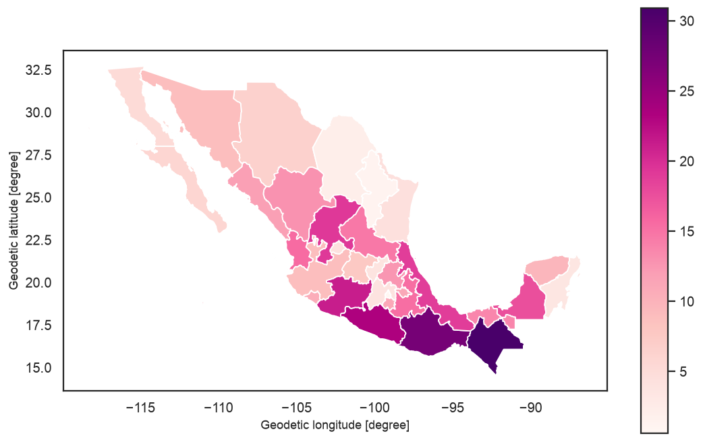
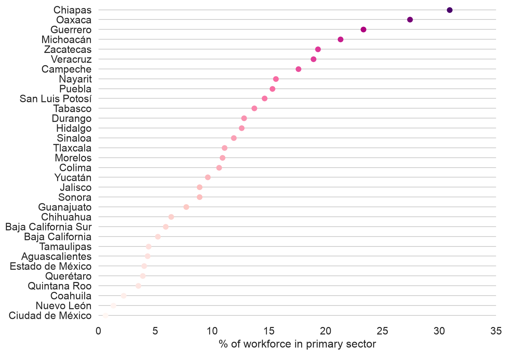

In this assignment, you're going to learn how to "put everything together" into the form of an interactive _dashboard_.  Dashboards are applications that may include multiple charts, which in some cases are configured to interact with one another.  While there _are_ many ways to build dashboards, you'll build yours in this assignment by "vibe coding" it with an AI assistant, as we discussed in class.

You do not need a paid AI subscription for this assignment.  The free tiers of ChatGPT, Claude, or Gemini are sufficient.  Your dashboard should be a single HTML file.

__Assignment scenario__

At the end of our class on geographic data and visualization, we discussed the pros and cons of visualizing data with maps or charts, or vice versa.  As a refresher, we compared the following map of primary sector employment by state in Mexico:



With the following `seaborn` dot plot:



Certainly, there are advantages and disadvantages to each plot; for example, the map shows geographic clustering (e.g. high values in the south of Mexico), whereas the plot more clearly displays quantitative differences between states.  A solution to this could be to include both visualizations in a report (like in a Jupyter Notebook!) to show the data in different ways.  However: there are also ways to include both the map and the dot plot in the same graphic - and make the two visuals interact with each other!  Creating charts like this is something you'll learn how to do in this assignment.

### Mapping Mexican states

You'll be working with the same dataset on Mexico's states that we've used in class.  For your dashboard, choose any one of the following columns:

* `gdp_pc`: GDP per capita in 2024, in thousands of pesos
* `gdp_growth`: percent change in GDP from 2023 to 2024
* `pri`: percent of the workforce employed in the primary sector
* `sec`: percent of the workforce employed in the secondary sector
* `ter`: percent of the workforce employed in the tertiary sector
* `pct_65plus`: percent of the population age 65 and up

The data come from Mexico's National Institute of Statistics and Geography (INEGI) and National Population Council (CONAPO):

* GDP: INEGI, [Producto Interno Bruto por Entidad Federativa](https://www.inegi.org.mx/programas/pibent/2018/), 2024
* Employment by sector: INEGI, [Encuesta Nacional de Ocupación y Empleo](https://www.inegi.org.mx/programas/enoe/15ymas/), second quarter of 2026
* Population: CONAPO, [Proyecciones de población](https://www.datos.gob.mx/dataset/proyecciones-de-poblacion), 2024

Open your AI tool of choice (ChatGPT, Claude, Gemini, etc.) and give it a prompt like this:

```
Build me a web page with an interactive map of Mexico's states.

The map should:
- Load its data from this GeoJSON file:
  https://raw.githubusercontent.com/walkerke/geog30323/main/data/mexico.geojson
- Color each state by the "[your column]" column, which is
  [describe your column]
- Include a legend
- Show the state's name (the "name" column) and its value
  when I hover over a state

Give me a single HTML file I can open in a browser.
```

Download the HTML file that your AI assistant gives you, and double-click the file to open it in your web browser.  You now have an interactive map of Mexico!

### Charting your data with a dot plot

The other visualization scenario we discussed in class was a dot plot, created in `seaborn` with the `stripplot()` function.  Ask your AI assistant to add a dot plot to your web page, next to your map.  Your dot plot should:

* Show a dot for each state, with the state names on the y-axis and your column on the x-axis
* Be sorted in descending order
* Use the same color palette you used for your map

### Building a linked dashboard

You've now re-created the two charts from our scenario.  Your next step is to build a visualization that incorporates both of these chart types - the map and the dot plot - and enables communication between the two.

Ask your AI assistant to link the two charts, so that hovering over a dot in your dot plot will highlight the corresponding state on the map, and vice versa.  Try it out!

### Iterate

Once you have a working dashboard, improve it through follow-up prompts.  Try at least 2-3 rounds of iteration.  Here are some ideas:

* "Add a drop-down menu that lets me switch between primary, secondary, and tertiary sector employment"
* "Improve the tooltip design - round the numbers and use readable names"
* "Make the layout work better on narrow screens"
* "Add a title above the charts"

This is by no means the only or best way to do things!  Spend some time exploring the options and modifying the layout of your dashboard as you see fit.

### Test and debug

* Download your updated HTML file and open it in a browser
* If something doesn't work, open the browser console (F12 > Console)
* Share error messages with your AI assistant to debug

### Check your work

Even if your dashboard runs without any errors, it may not be showing the data correctly.  Before you submit, [take a look at the data](https://github.com/walkerke/geog30323/blob/main/data/mexico.csv) and check the following:

* Pick three states and hover over them.  Do the values you see match the values in the data?
* Is your dot plot sorted correctly?
* Do the colors on your map and your dot plot match?

### Submission

To receive credit for Assignment 9, submit the following to the Assignment 9 submission console on TCU Online:

* __Your dashboard__: Your HTML file
* __Reflection (200-300 words)__: What did your AI assistant get right on the first try?  What did you have to ask it to fix?  How did you check that your dashboard is showing the data correctly?  What more did you do to make your dashboard stand out, beyond the AI's defaults?  You can type your reflection in the text box, or upload it as a document.
