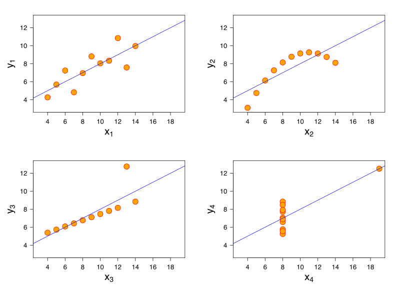

## Data visualization

* Thus far: we've learned how to use data visualization to explore our data
* In the weeks to come: 
    * Best practices in data visualization
    * Advanced chart types
    * Interactive visualization
    * Geographic visualization (maps!)
    * Putting it all together!

---

<figcaption>Source: Charles Minard (1869)</figcaption>

---

<figcaption>Source: Wikimedia Commons</figcaption>

---

<figcaption>Source: Nathan Yau/FlowingData</figcaption>

---

### Anscombe's Quartet

<figcaption>Source: Wikimedia Commons</figcaption>

---

### Considerations when visualizing data

* What are you visualizing? 
* Who is your audience? 
* In what format will you be presenting the visualization?  

---

### Visual variables

<figcaption>Source: _Data Points_</figcaption>

---

## Color

* Hue: color, commonly understood (red, blue, green)
* Lightness or Value: extent to which color is light or dark
* Saturation: vividness of the color


---

## Color schemes

<figcaption>Source: _Data Points_</figcaption>

---

### Color and context

<figcaption>Source: FiveThirtyEight (2014)</figcaption>

---

## Color-blindness

<figcaption>Source: SBNation.com</figcaption>

---

### Good use of color

<figcaption>Source: Kirk Goldsberry/_Grantland_</figcaption>

---

### Poor use of color

<figcaption>Source: Jonathan Cohn via Kenneth Field/[Cartonerd](http://cartonerd.blogspot.com/2014/08/the-reason-for-cartography.html)</figcaption>

---

### Color and visual variables

<figcaption>[Image link/source](http://pixelspread.com/images/beards_trust_2.jpg)</figcaption>

---

## Data for examples

```python
import seaborn as sns
import pandas as pd
import matplotlib.pyplot as plt
from pandas_datareader import wb
sns.set_theme(style = "whitegrid", rc = {"figure.figsize": (10, 8)})

eu_countries = ['AT', 'BE', 'BG', 'HR', 'CY', 'CZ', 'DK', 'EE', 'FI', 'FR',
                'DE', 'GR', 'HU', 'IE', 'IT', 'LV', 'LT', 'LU', 'MT', 'NL',
                'PL', 'PT', 'RO', 'SK', 'SI', 'ES', 'SE']

ue = wb.download(indicator = "SL.UEM.TOTL.ZS", 
                 country = eu_countries, start = 1991, 
                 end = 2025)

ue.reset_index(inplace = True)
ue.columns = ['country', 'year', 'unemployment']
# Convert the year to integer for better labels
ue = ue.assign(year = ue.year.astype(int))
```

---

## The 'heat map'

<figcaption>Source: [_The Wall Street Journal_](http://graphics.wsj.com/infectious-diseases-and-vaccines/)</figcaption>

---

## Heat maps in `seaborn`

* Available in `seaborn`'s `heatmap()` function; takes a wide data frame with y-values in the index and x-values as column headers

```python
ue_wide = ue.pivot(index = 'country', columns = 'year', 
                   values = 'unemployment')

sns.heatmap(ue_wide)
```
---

### The `seaborn` 'heat map' 


---

### Color palettes in `seaborn`

* ColorBrewer: popular color schemes for visualization
* Support for ColorBrewer built into `seaborn`; available in the `color_palette()` function
* See more at <https://colorbrewer2.org/>

---

### Color in `seaborn`

```python
ue25 = (ue
  .query('year == 2025')
  .sort_values('unemployment',
                ascending = False)
)

sns.barplot(x = 'unemployment', y = 'country',
            data = ue25, hue = 'country',
            palette = "Greens_r", legend = False)
```

---

### Color in `seaborn`


---

### Highlighting and annotation

<figcaption>Source: Nathan Yau/[FlowingData](https://flowingdata.com/2023/07/03/competitive-hot-dog-eating-requirements/)</figcaption>

---

### The "spaghetti" chart

```python
sns.lineplot(data = ue, x = "year", y = "unemployment", 
             hue = "country")
```


---

## Highlighting


---

### Highlighting code

```python
# Make a Greece-only dataset
greece = ue.query('country == "Greece"')
# Plot every country in grey, first
sns.lineplot(data = ue, x = "year", y = "unemployment",
             units = "country", estimator = None,
             color = "grey")
# Then, plot Greece on top
sns.lineplot(data = greece, x = "year", y = "unemployment",
             hue = "country", palette = ["blue"], linewidth = 3)
```

---

### Annotation in Python


---

### Annotation code

```python

plt.annotate('Global recession \nspreads to Europe', xy = (2009, 9.5), 
             xycoords = 'data', xytext = (2005, 23), textcoords = 'data', 
             arrowprops = dict(arrowstyle = 'simple', color = '#000000'))
```

---

### Text as legend


---

### Text as legend code

```python
countries = ["Spain", "Greece", "Italy", "Germany"]
four = ue[ue["country"].isin(countries)]
sns.lineplot(data = four, x = "year", y = "unemployment",
             hue = "country", hue_order = countries, legend = False)
# Label each line at its end, in the matching color
end = four.query('year == 2025').set_index('country')
for country, color in zip(countries, sns.color_palette()):
    plt.text(2025.5, end.loc[country, 'unemployment'], country,
             color = color, va = 'center', fontweight = 'bold')
# Make room for the labels
plt.xlim(1990, 2030)
```

---

### Small multiples

<figcaption>Source: _Data Points_</figcaption>

---

### Small multiples in Python

```python
ue.sort_values("country", inplace = True)

sns.relplot(data = ue, x = "year", y = "unemployment", 
            col = "country", col_wrap = 7,
            kind = "line", height = 2.5)
```
---

### Small multiples in Python


---

### Modifying chart options

* `seaborn` is a wrapper around `matplotlib`, the main plotting engine for Python
* In turn, all `matplotlib` customization methods are available for your `seaborn` plots - and there are many!
* To get access: `import matplotlib.pyplot as plt`

---

### Formatting axes & labels

* Example: 

```python
plt.figure(figsize = (10, 7))

sns.heatmap(ue_wide, cmap = 'YlGnBu')

plt.ylabel("")
plt.xlabel("")
plt.title("Unemployment in Europe, 1991-2025")
plt.xticks(rotation = 45)
```

---

### Modified heatmap


---

### `seaborn` and `matplotlib`

* `seaborn` returns a `matplotlib` object that can be modified by the options in the `pyplot` module
* Often, these options are wrapped by `seaborn` and available as arguments - so check the documentation to see what you can do!  

---

### Image resolution

* Higher __resolution__: greater detail in an image
* Commonly: _dpi_ (dots per inch)


---

### Exporting your visualizations

* To save your visualizations from Colab: 

```python
plt.savefig('destfile.jpg', dpi = 300)
```


<style>

.reveal section img {
  background:none; 
  border:none; 
  box-shadow:none;
  }

h3 {


}
  
</style>

