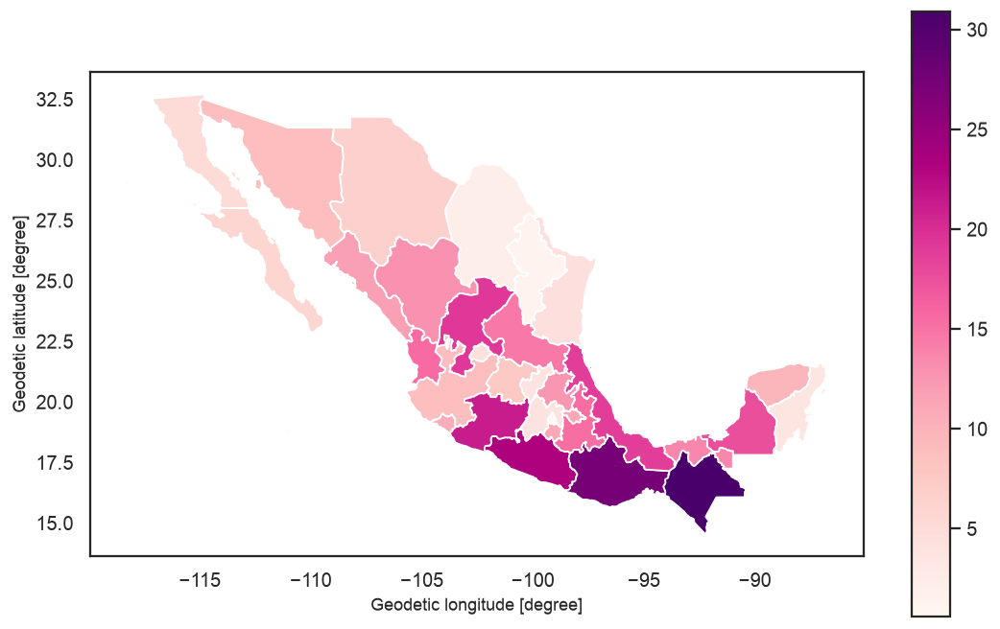
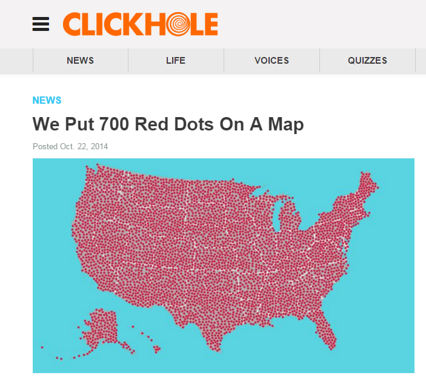

## What is geographic data? 

* Thus far: we've been working with data (largely) in tabular data frames, where each column represents data "attributes"
* Geographic data: includes information on _location_ - specifically, where the observation is located on the Earth's surface

---

### Maps!

<iframe id="immigrant-map" height="560" width="900" frameborder="0"></iframe>

```{=html}
<script>
(function () {
  var f = document.getElementById("immigrant-map");
  if (f) f.src = "https://personal.tcu.edu/" + "kylewalker/immigrant-america/";
})();
</script>
```

---

### Longitude and latitude: the basics


---

### Geographic coordinates

* Longitude (X) and latitude (Y) coordinates can be expressed as:
  + Degrees minutes seconds (e.g. $97^{\circ}21'37''W$, $32^{\circ}42'38''N$)
  + Decimal degrees (e.g. $-97.36$, $32.71$)

Conversion between DMS and decimal degrees:

$$DD = D + \frac{M}{60} + \frac{S}{3600}$$

---

## Coordinate systems

* __Geographic coordinate system__: coordinate system based on latitude and longitude (coordinates on a sphere)
* __Projected coordinate system__: coordinate system projected onto a two-dimensional surface (coordinates on a plane)

---

## Map projections

<iframe id="projections-demo" width="960" height="510" frameborder="0" scrolling="no"></iframe><figcaption>Original source: Mike Bostock</figcaption>

```{=html}
<script>
(function () {
  var f = document.getElementById("projections-demo");
  if (f) f.src = "https://personal.tcu.edu/" + "kylewalker/introgis/projections.html";
})();
</script>
```

---

### Tiled mapping and Web Mercator


---

## Vector data


---

## Raster data


---

### Vector data: CSV files

* Example: Starbucks locations in Chicago 

```python
import pandas as pd

starbucks = pd.read_csv("https://raw.githubusercontent.com/walkerke/geog30323/main/data/chicago_starbucks.csv")

starbucks.head()
```

---

## GeoPandas

* __GeoPandas__: Python package that extends __pandas__ to represent geographic objects as _GeoDataFrames_

* Key column: `geometry`, which represents the geometry type of the data (point, line, or polygon) and the sequence of coordinates

---

## Installing packages in Colab

* Google Colab has many Python packages you'll need for your work pre-installed, but not all!

* Packages can be installed from the Python Package Index using the `pip` command prefaced with an exclamation mark

```bash
!pip install pytidycensus contextily rasterio
```

---

### Making a GeoDataFrame

```python
import geopandas as gp

sbgeo = gp.GeoDataFrame(starbucks,
                        geometry = gp.points_from_xy(starbucks.Longitude,
                                                     starbucks.Latitude),
                        crs = 4326)
```

---

### Making a GeoDataFrame

* `gp.GeoDataFrame()`: function used to generate the GeoDataFrame, which can take an existing __pandas__ DataFrame as its first argument

* Parameters: 
  - `geometry`: how to represent the data as a geographic object. We use the `gp.points_from_xy()` function here to "make" the geometry from existing `Longitude` and `Latitude` columns. 
  - `crs`: a code that specifies the dataset's _coordinate reference system_. Most coordinate systems can be represented by 4- or 5-digit codes (see <https://spatialreference.org/>)

---

### Mapping point data

```python
# Static plot:
sbgeo.plot()

# Interactive map: 
sbgeo.explore(tiles = "Esri.WorldGrayCanvas")
```


---

### Adding a "basemap" to a static map

```python
import contextily as cx

# "Project" to Web Mercator, used by tiled mapping services
sbgeo2 = sbgeo.to_crs(3857)

# Assign the Starbucks map to a variable, then add the basemap to it
p = sbgeo2.plot(figsize = (8, 8))
cx.add_basemap(p, zoom = 11, source = cx.providers.Esri.WorldGrayCanvas)
```

---

### Adding a "basemap"


---

### Vector data: GeoJSON

* Extension to the JSON format that encodes geographic coordinates for datasets

* [Mexico's states as GeoJSON](https://github.com/walkerke/geog30323/blob/main/data/mexico.geojson)

---

### Mapping polygons

```python
mxgeo = gp.read_file("https://raw.githubusercontent.com/walkerke/geog30323/main/data/mexico.geojson")

import seaborn as sns
sns.set_theme(style = "white")
mxgeo.plot(column = "pri", cmap = "RdPu", figsize = (10, 8),
           legend = True)

# Or, interactively:
mxgeo.explore(column = "pri", cmap = "RdPu",
              tiles = "Esri.WorldGrayCanvas")
```

---

### Mapping polygons



---

### Should you map? 

* Beware the "amazing map"...

<div style="text-align: center;"><figcaption>Source: [Clickhole (The Onion)](https://clickhole.com/we-put-700-red-dots-on-a-map-1825122391/)</figcaption></div>

---

### Maps vs. charts

* For discussion: which visualization is more effective for showing differences in our data?   

---

### Chart for comparison


---

### Code to reproduce the chart

```python
import pandas as pd, seaborn as sns, matplotlib.pyplot as plt
sns.set_theme(style="whitegrid", font_scale = 1.3)
df = pd.read_csv("https://raw.githubusercontent.com/walkerke/geog30323/main/data/mexico.csv")

plt.figure(figsize = (10, 8))

p = sns.stripplot(data = df.sort_values('pri', ascending = False), 
                  x = 'pri', y = 'name', palette = "RdPu", 
                  orient = 'h', size = 8, hue = 'pri', legend = False)
p.set(xlabel = "% of workforce in primary sector", 
      xlim = (0, 35), ylabel = "")
p.axes.xaxis.grid(False)
p.axes.yaxis.grid(True)
sns.despine(left = True, bottom = True)

```
---

## Automated spatial data acquisition

* We've discussed getting data from APIs to stream data in to your analysis session

* __pytidycensus__: Python package to automate acquisition of US Census Bureau geographic data

* Let's try it out!

---

## pytidycensus example

```python
import pytidycensus as tc

tc.set_census_api_key("YOUR KEY HERE")

tarrant_income = tc.get_acs(geography = "tract",
                            variables = {"median_income": "B19013_001"},
                            state = "TX", county = "Tarrant",
                            year = 2024, geometry = True)
```

---

## Mapping Census data

```python
# Income comes back as an "object" column; convert it to numbers first
tarrant_income["median_income"] = pd.to_numeric(tarrant_income["median_income"])

tarrant_income.explore(column = "median_income",
                       tiles = "Esri.WorldGrayCanvas")
```

---

### Spatial joins: Chicago tracts

```python
cook = tc.get_acs(geography = "tract", state = "IL", county = "Cook",
                  variables = {"median_income": "B19013_001"},
                  year = 2024, geometry = True)
cook["median_income"] = pd.to_numeric(cook["median_income"])

places = tc.get_acs(geography = "place", state = "IL", variables = "B01003_001",
                    year = 2024, geometry = True)
chicago = places.query('NAME == "Chicago city, Illinois"')

# Keep the Cook County tracts that fall inside Chicago's city limits
chi_tracts = cook[cook.representative_point().within(chicago.geometry.iloc[0])]
```

---

### Spatial joins: which tracts have a Starbucks?

```python
# Match each Starbucks to the tract it falls within
joined = gp.sjoin(sbgeo.to_crs(chi_tracts.crs), chi_tracts, predicate = "within")

chi_tracts = chi_tracts.assign(has_starbucks = chi_tracts.GEOID.isin(joined.GEOID))

chi_tracts.groupby("has_starbucks").median_income.median()
```

```
has_starbucks
False     67986.0
True     106360.5
Name: median_income, dtype: float64
```

---

### Mapping the result

```python
p = chi_tracts.plot(column = "median_income", cmap = "YlGnBu", legend = True,
                    figsize = (8, 8), missing_kwds = {"color": "lightgrey"})
sbgeo.to_crs(chi_tracts.crs).plot(ax = p, color = "red", markersize = 8)
```


---

## Raster data in Python

* To work with raster data in Python, use the [rasterio](https://rasterio.readthedocs.io/en/latest/index.html) package

```python
import rasterio as rio

# Dataset of elevation in the Tarrant County area
elev = rio.open("https://personal.tcu.edu/kylewalker/data/tarrant_elevation.tif")
```

---

### Plotting raster data

```python
from rasterio.plot import show, show_hist
sns.set_theme(style = "white")
show(elev)
```


---


### Raster data: histograms

```python
fig, ax = plt.subplots()
show_hist(elev, ax = ax, bins = 100)
ax.get_legend().remove()
```


<style>

.reveal section img {
  background:none; 
  border:none; 
  box-shadow:none;
  }
  


</style>


