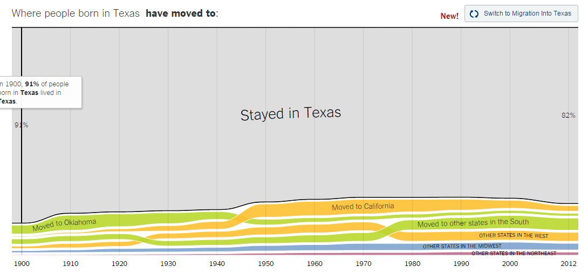
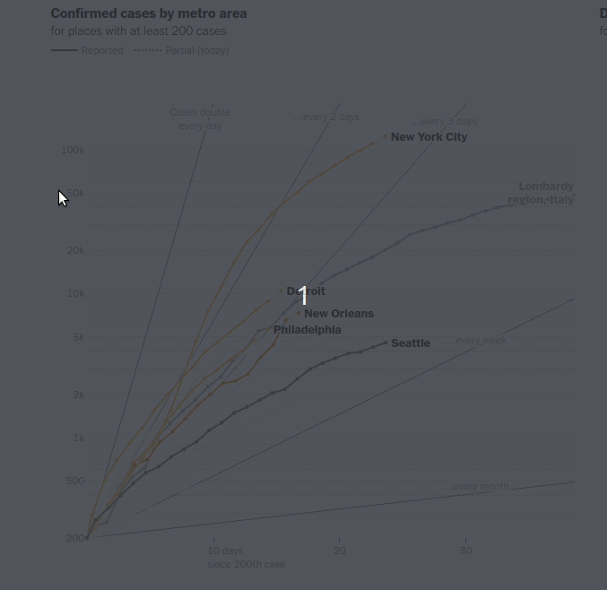
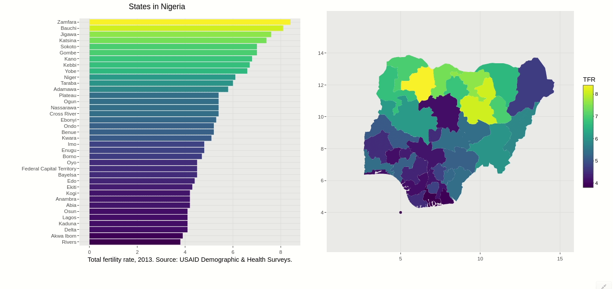

## Course recap

* Thus far: we've focused on _exploratory data analysis_, which involves data wrangling, summarization, and visualization
* Your data analysis journey shouldn't stop here!  Topics to consider:
    * _Explanatory_ vs. exploratory visualization
    * Statistics and data science
    * Data ethics and "big data"

---

### Communicating with data

* Once you've done all of the hard work wrangling your data, you'll want to communicate insights to others!
* This might include:
    * Polished data products or reports
    * Models that can scale your insights

---

### Explanatory visualization

* We've largely worked to this point with _exploratory visualization_, which refers to internally-facing visualizations that help us reveal insights about our data
* Often, externally-facing data products will include _explanatory visualization_, which include a polished design and emphasize one or two key points

---

### Infographics

Obesity infographics:

* [Example #1](https://s-media-cache-ak0.pinimg.com/736x/41/4b/1b/414b1b7627feca460785a8eb749c2f38.jpg)
* [Example #2](https://www.aace.com/images/pj-obesity-infographic/AACE_obesity_patient_Journey_Infographic_02.jpg)
* [Example #3](img/10-interactive/obesity-infographic-chatgpt.png)

---

### Are infographics useful?

* XKCD: <https://xkcd.com/1273/>

---

### Interactive reports

* Example: a data journalism article - or your Jupyter Notebook!
* Key distinction: your code, data exploration, etc. will likely be external to the report (this can vary depending on the context, however)

---

### Data storytelling

<iframe id="rosling-clip" width="853" height="480" frameborder="0" allowfullscreen></iframe>

```{=html}
<script>
(function () {
  var f = document.getElementById("rosling-clip");
  if (f) f.src = "https://www.youtube.com/embed/" + "jbkSRLYSojo";
})();
</script>
```

---

### Why interactive visualization?

* User is an _active participant_ rather than a _passive observer_
* Key points to consider:
    * What are you visualizing?
    * What is the purpose of your visualization?
    * Who is your audience?
    * In what format and venue will you be presenting the visualization?

---

### Interactive data journalism

<div style="text-align: center;">[](https://www.nytimes.com/interactive/2014/08/13/upshot/where-people-in-each-state-were-born.html#Texas)<figcaption>Source: _The New York Times_</figcaption></div>

---

### Interactivity in the Notebook

* The `ipywidgets` package allows you to build basic graphical user interfaces (GUIs) to explore your data in the Notebook
* How it works: supply a function to the `interact` function in `ipywidgets`

```python
from ipywidgets import interact

def add_five(x):
    print(x + 5)

interact(add_five, x = (1, 100))

```

---

## Interactivity with plots

```python
import pandas as pd
import seaborn as sns
import matplotlib.pyplot as plt

mx = pd.read_csv("https://raw.githubusercontent.com/walkerke/geog30323/main/data/mexico.csv")

cols = ['gdp_pc', 'pri', 'sec', 'ter', 'pct_65plus']

def make_plot(x, y, title):
    sns.lmplot(data = mx, x = x, y = y)
    plt.title(title)
    plt.show()

interact(make_plot, x = cols, y = cols, title = "Enter a plot title!")
```

---

### Widgets: not just for plots!

```python
import geopandas as gp

crime = gp.read_file("https://raw.githubusercontent.com/walkerke/geog30323/main/data/fort_worth_crime_2025.geojson")

def get_offense(offense = ['PUBLIC INTOXICATION', 'DWI', 'FRAUD']):
    df = crime[crime.Nature_Of_Call == offense]
    return df.head()

interact(get_offense)
```

---

## Ipywidgets fundamentals

Arguments used in `interact()` correspond to the following:

* A __boolean__ (`True` or `False`) returns a __checkbox__
* A __string__ returns a __text input__
* A __number__ (integer or float) returns a __slider__
* A __tuple of numbers__ (start, end, step size) returns a __range slider__
* A __list__ returns a __drop-down menu__

Experiment with the functions you've written this semester!

---

### Interactive visualization and the web

* Analytical workflows have become increasingly connected to the web - or even completely web-based
* Interactive data visualization: graphics not just _on_ the web, but _of_ the web

---

### Filtering & highlighting

<div style="text-align: center;"><figcaption>Image source: [_The New York Times_](https://www.nytimes.com/interactive/2020/04/03/upshot/coronavirus-metro-area-tracker.html)</figcaption></div>

---

### Linked charts

<div style="text-align: center;"><figcaption>[Link to live example](https://rpubs.com/walkerke/nigeria-tfr)</figcaption></div>

---

### Interactive visualization in Python

* [Altair](https://altair-viz.github.io/)

* [Bokeh](https://docs.bokeh.org/en/latest/index.html)

* [Plotly](https://plotly.com/python/)

---

## Altair example

```python
import altair as alt

alt.Chart(mx).mark_circle(size = 60).encode(
    x = "pri",
    y = "gdp_pc",
    tooltip = ["name", "gdp_pc", "pri"]
).interactive()
```

---

### Data dashboards

* __Dashboards__ are applications that may include multiple charts, which in some cases are configured to interact with one another

---

### What is "vibe coding"


---

### Should you "vibe code?"

* You absolutely should be using AI assistants when you write code. However:

* You can't just build apps on "vibes" alone

* You need to think and act like an engineer / project manager

* Clear direction and _plenty of context_ will help your project succeed

---

### Demo: vibe coding a dashboard

* Let's build a dashboard with the Mexico data

---

### "Slop"

> digital content of low quality that is produced usually in quantity by means of artificial intelligence

<figcaption>Merriam-Webster's 2025 Word of the Year ([WBUR](https://www.wbur.org/news/2025/12/16/merriam-webster-word-of-year-slop-ai-dictionary))</figcaption>

---

### Assignment 9


<style>

.reveal section img {
  background:none;
  border:none;
  box-shadow:none;
  }

h3 {


}

</style>
